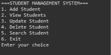
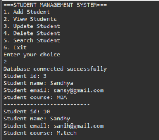
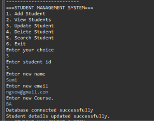

# Student Management System (Java + MySQL)

A console-based Student Management System developed using Java, JDBC, and MySQL. The application allows users to manage student records with database-backed CRUD operations.

## Features

- **Add Student:** Add new student records to the database.
- **View Students:** Display all registered students.
- **Update Student:** Modify student name, email, and course.
- **Delete Student:** Delete a student record using their ID, with confirmation.
- **Search Student:** Find a student using their ID.
- **Input Validation:** Handle invalid inputs and empty fields.
- **Duplicate ID Prevention:** Prevent duplicate student IDs.

## Technologies Used

- Java
- JDBC (Java Database Connectivity)
- MySQL
- MySQL Connector/J
- Eclipse IDE

## Database Setup

Create a database named `student_management`:

```sql
CREATE DATABASE student_management;

USE student_management;
```

Create the students table:

```sql
CREATE TABLE students (
    id INT PRIMARY KEY,
    name VARCHAR(100) NOT NULL,
    email VARCHAR(100) NOT NULL,
    course VARCHAR(100) NOT NULL
);
```

## Project Structure

```text
Student-Management-System/
│
├── myPackage/
│   ├── Main.java
│   ├── Student.java
│   ├── StudentManagement.java
│   └── DBConnection.java
│
├── module-info.java
└── README.md
```

## How to Run

1. Install Java JDK and Eclipse IDE.
2. Install MySQL Server and MySQL Workbench.
3. Create the database and students table using the SQL commands above.
4. Download MySQL Connector/J.
5. Add the MySQL Connector/J JAR to the project's build path.
6. Configure your MySQL username and password in `DBConnection.java`.
7. Open the project in Eclipse.
8. Run `Main.java`.

## Application Menu

The application provides the following menu options:

1. Add Student
2. View Students
3. Update Student
4. Delete Student
5. Search Student
6. Exit

## Concepts Practiced

- Object-Oriented Programming (OOP)
- JDBC connectivity
- MySQL database operations
- CRUD operations
- PreparedStatement and ResultSet
- Exception handling
- Try-with-resources
- Input validation
- Menu-driven Java applications

## Application Screenshots

### 1. Main Menu


### 2. View Students


### 3. Update Student

## Author

**Sandhya Bharti**

B.Tech Computer Science and Engineering

GitHub: [SandhyaCodes5](https://github.com/SandhyaCodes5)
